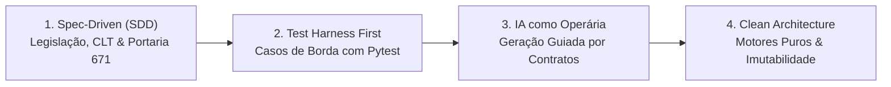
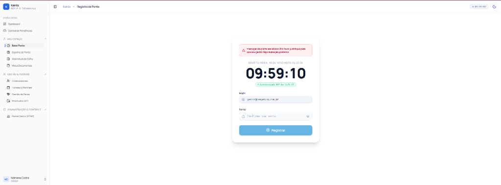
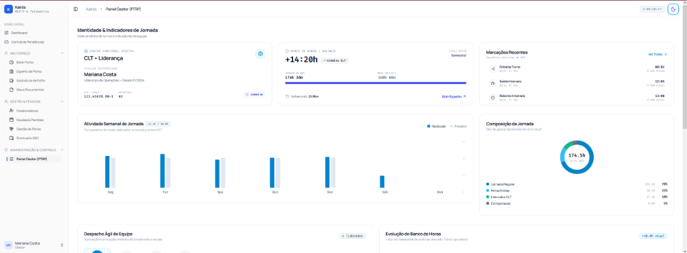
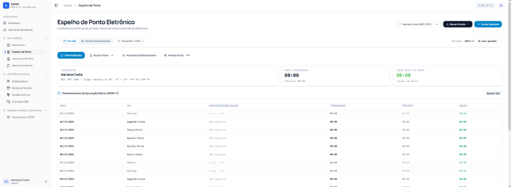
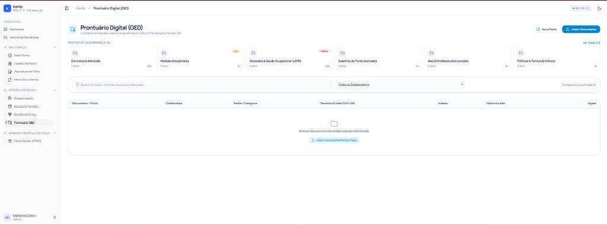

# ⏱️ Kairós — Sistema de Ponto Corporativo & Compliance Fiscal (REP-P / PTRP)

> **Estudo de Caso de Engenharia de Software Assistida por IA**  
> Como arquitetei e construí um SaaS corporativo de alta complexidade regulatória (Portaria MTP nº 671/2021, CLT e LGPD) utilizando Inteligência Artificial através de uma **esteira de engenharia rigorosa — sem cair na armadilha do "vibe coding"**.

[](https://fastapi.tiangolo.com/)
[](https://react.dev/)
[](https://tailwindcss.com/)
[](/samples)
[-critical?style=flat-square)](PROPRIETARY_NOTICE.md)

---

## 👤 Sobre Mim & O Propósito Deste Repositório

Olá! Meu nome é **Victor Lacerda**. Atuo como **Supervisor de Suporte Técnico** e estou em transição ativa para **Engenharia de Software (nível Júnior)**.

Não tenho 10 anos de experiência como sênior — e não pretendo fingir que tenho. Mas tenho algo que considero fundamental na nova era do desenvolvimento: **compreensão profunda da dor do negócio, rigor de engenharia e a habilidade de orquestrar ferramentas de IA para entregar software corporativo robusto, testado e com valor real**.

Este repositório é um **Estudo de Caso Público** do sistema **Kairós**, uma solução completa de ponto eletrônico corporativo que desenvolvi de forma quase autônoma. O código-fonte integral de produção é mantido privado por razões de propriedade intelectual e conformidade corporativa ([veja o aviso legal aqui](PROPRIETARY_NOTICE.md)), mas este showcase disponibiliza a arquitetura, a metodologia e uma amostra executável do motor de cálculo.

---

## Por que este projeto NÃO é "Vibe Coding"?

Em 2025/2026, convencionou-se chamar de *"vibe coding"* o ato de abrir um chat de IA, digitar comandos genéricos (*"faça um sistema de ponto"*), colar código sem entender e torcer para compilar. 

Em sistemas críticos, **o "vibe coding" é uma receita para o desastre**:
- No Brasil, um sistema de ponto eletrônico (**REP-P**) lida com a **Portaria MTP nº 671/2021**. Qualquer erro em cálculo de tolerância da CLT, cômputo de hora noturna ou supressão de intervalo gera **passivo trabalhista milionário** e autuações fiscais graves;
- Se você pedir para uma IA comum fazer um CRUD de ponto, ela vai criar operações de `UPDATE` e `DELETE` em batidas — o que é **expressamente proibido por lei federal**.

### A Nossa Esteira de Produção com IA (AI-Assisted Rigor)

Em vez de "vibe coding", montamos uma **esteira de engenharia guiada por restrições humanas**:



1. **Spec-Driven Development (SDD):** Antes de gerar qualquer linha de código com IA, mapeei os requisitos legais e de negócio:
   - Coleta Livre e Irrestrita (Art. 74 e 80 da Portaria 671 — o sistema jamais bloqueia batidas);
   - Tolerâncias do Art. 58 § 1º da CLT e Súmula 366 do TST (limite de 5 min por batida e 10 min diários);
   - Adicional noturno urbano com hora ficta reduzida de 52m30s (Art. 73 da CLT);
   - Arquivos fiscais oficiais **AFD** (Tipos 1, 7 e 9) e **AEJ**.
2. **Harness de Testes Automatizados:** Para cada funcionalidade, criei cenários de teste automatizados antes ou em conjunto com a implementação. A IA só tinha seu código aprovado se passasse em suítes exaustivas de testes no `pytest`.
3. **Clean Architecture Concêntrica:** A IA foi estritamente instruída a isolar o domínio das camadas de framework. O motor de cálculo (`CalculationEngine`) é **100% puro**, sem dependência de banco de dados ou FastAPI.
4. **Event Sourcing & Imutabilidade:** Em vez de atualizar registros existentes, o sistema implementa um **ledger append-only com cadeia criptográfica SHA-256 e Número Sequencial de Registro (NSR)** ininterrupto.
5. **Governança Git:** Rastreabilidade por tickets, commits convencionais e scripts de automação para garantir banco de dados reprodutível.

> 📖 **Leia o manifesto completo da metodologia em:**  
> [docs/methodology/ai-engineering-pipeline.md](docs/methodology/ai-engineering-pipeline.md)

---

## Decisões de Arquitetura (ADR em Destaque)

Para ilustrar o nível de maturidade arquitetural adotado, disponibilizamos o Registro de Decisão Arquitetural oficial:

- [ADR-001: Adoção de Event Sourcing & Ledger Imutável no Registro de Ponto](docs/architecture/ADR-001-event-sourcing-and-portaria-671.md)  
  *Explica por que o modelo relacional tradicional (CRUD mutável) foi rejeitado em favor de uma stream imutável com encadeamento de hash SHA-256 para garantir auditabilidade forense e cumprimento da Portaria 671.*

---

## Amostra Executável: Teste Você Mesmo em 10 Segundos!

Para comprovar que a lógica foi desenvolvida com rigor matemático e cobertura de testes, disponibilizamos uma **amostra autocontida e higienizada** do motor puro de cálculo trabalhista na pasta [`samples/`](samples/).

### Como rodar localmente:

```bash
# 1. Clone este repositório de showcase
git clone https://github.com/Varto-Kai/sistema-de-pontos-showcase.git
cd sistema-de-pontos-showcase

# 2. Instale o pytest (se ainda não tiver)
pip install pytest

# 3. Execute a suíte de testes da amostra:
pytest samples/ -v
```

Você verá a execução de testes validando:
- ✅ Tolerância da CLT dentro do limite (Art. 58 § 1º);
- ✅ Cômputo integral de atrasos quando o limite é quebrado (Súmula 366 TST);
- ✅ Cômputo integral de horas extras;
- ✅ Direcionamento correto para banco de horas;
- ✅ Redução da hora ficta noturna urbana (fator 60 / 52,5).

---

## 💻 Stack Tecnológica

| Camada | Tecnologias Utilizadas |
| :--- | :--- |
| **Backend** | Python 3.12, FastAPI, Pydantic v2, SQLAlchemy 2.0, Uvicorn, PyJWT |
| **Frontend** | React 19, TypeScript, Vite 6, Tailwind CSS v4, Lucide Icons |
| **Gerenciamento de Estado** | TanStack Query v5 (cache de API), Zustand (estado local/offline) |
| **Persistência** | PostgreSQL 18 (Produção) / SQLite (Local Sandbox) |
| **DevOps & QA** | Docker, Docker Compose, Pytest, Git Hooks, GitHub Issues |
| **Design System** | Tipografia `Manrope` e `Fira Code`, Modo Claro & Modo Escuro Deep Oceanic Cyan |

---

## 📸 Demonstração Visual da Interface

A interface do Kairós foi projetada com alta convicção estética (anti-"AI slop"), unificada na tipografia **Manrope**, cartões de precisão técnica e foco na eficiência diária do RH e dos colaboradores:

| 1. Registrador REP-P com Relógio Atômico em Tempo Real | 2. Painel do Gestor (PTRP & Telemetria de Equipe) |
| :---: | :---: |
|  |  |

| 3. Espelho de Ponto & Fechamento de Competência | 4. Prontuário Digital (GED) & Governança LGPD |
| :---: | :---: |
|  |  |

---

## 🤝 Vamos Conversar? (Live Code Walkthrough)

Se você é **recrutador técnico, Tech Lead ou gestor de contratação**, sei que olhar apenas um repositório de showcase pode deixar perguntas em aberto.

Por isso, estou à disposição para um **Code Walkthrough ao vivo de 20 minutos**:
- Mostro o sistema rodando localmente de ponta a ponta;
- Compartilho minha tela e explico as decisões de código no backend e frontend;
- Executo as suítes de testes automatizados e demonstro o fluxo de dados;
- Explico como orquestrei as ferramentas de IA para alcançar essa produtividade sem abrir mão da qualidade.

- **LinkedIn:** [https://www.linkedin.com/in/victorlmendes/](https://www.linkedin.com/in/victorlmendes/)
- **GitHub:** [@Varto-Kai](https://github.com/Varto-Kai)
- **E-mail:** [v.l.mendes17@gmail.com](v.l.mendes18@gmail.com)
