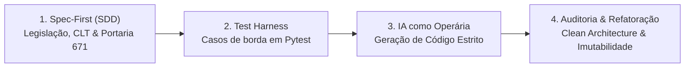

# 🛠️ Metodologia: Engenharia Assistida por IA vs. "Vibe Coding"

> *"Usar IA não é pedir para o ChatGPT adivinhar o seu sistema. É usar LLMs como geradores de força bruta de código dentro de uma esteira rigorosa de restrições humanas, testes e contratos."*

---

## 1. O Problema do "Vibe Coding" no Mercado Atual

Em 2025/2026, popularizou-se o termo **"Vibe Coding"**: abrir um editor com IA, digitar prompts vagos (*"faça um sistema de ponto"*), copiar o código gerado sem ler, torcer para rodar e rezar para não quebrar.

No desenvolvimento de um software regulatório como um **REP-P (Portaria MTP 671/2021)**, o "vibe coding" é catastrófico:
- A IA alucina regras de tolerância da CLT (ex: esquecer o limite diário de 10 min do Art. 58);
- Cria operações de `UPDATE` e `DELETE` em tabelas de ponto (o que constitui **infração trabalhista grave** com risco de anulação fiscal e processo);
- Acopla regras de negócio dentro de rotas HTTP ou componentes visuais;
- Gera código sem testes que quebra silenciosamente ao calcular horas extras e adicionais noturnos.

---

## 2. A Esteira de Engenharia de Produção Adotada

Como desenvolvedor em transição de carreira vindo da área de Suporte, entendi desde o primeiro dia que **a IA seria meu copiloto de produtividade, mas a responsabilidade pelo produto, conformidade jurídica e arquitetura seria 100% minha**.

Para isso, estabeleci uma esteira em **4 etapas obrigatórias**:

### Etapa 1: Spec-Driven Development (SDD)
Nenhum código foi solicitado à IA sem antes escrever a especificação de domínio em Markdown:
- Mapeamento literal dos artigos da **Portaria MTP nº 671/2021** (Art. 74 e 80: Coleta Livre e Irrestrita, vedação de bloqueio);
- Parâmetros da CLT (Art. 58 § 1º, Art. 59, Art. 71, Art. 73 com fator noturno 60/52.5 e Súmula 60 TST);
- Definição formal das interfaces de entrada e saída (Pydantic v2).

### Etapa 2: O "Harness" de Testes Antes da Aceitação
Para cada funcionalidade, criei cenários de teste automatizados com valores concretos:
- *O que acontece se o colaborador bater 08:04 e 17:02?* (Desvio de 6 min <= 10 min -> sem atraso).
- *O que acontece se bater 08:07 e 17:00?* (Desvio > 5 min -> atraso integral de 7 min).
- *O que acontece na escala noturna de 22:00 às 05:00?* (420 min de relógio devem virar 480 min de cálculo com hora ficta).
> **Regra de Ouro:** A IA só recebia permissão para avançar se todos os testes passassem com zero regressão.

### Etapa 3: Restrições Arquiteturais Rígidas (Clean Architecture)
A IA foi estritamente instruída através de regras de contexto (`AGENTS.md`) a nunca violar os princípios de design:
- Regras de cálculo no `CalculationEngine` são **funções matemáticas puras** (sem importar banco de dados, SQLAlchemy ou FastAPI);
- Inversão de dependência (DIP): O núcleo de negócio não depende de detalhes de infraestrutura;
- Imutabilidade (Event Sourcing): Batidas de ponto só geram eventos de acréscimo com encadeamento de hash SHA-256 e NSR.

### Etapa 4: Governança Git & Rastreabilidade de Issues
Cada implementação foi fatiada em tickets e issues reais no GitHub (`TASK-0XX`):
- Commits convencionais e rastreáveis;
- Testes de integridade rodando a cada merge;
- Scripts de saneamento e reset de banco para garantir reprodutibilidade (`reset_ambiente.py`).

---

## 3. O Papel do Desenvolvedor Junior na Era da IA

A IA não diminui o valor do engenheiro — ela **muda a natureza do trabalho**:
1. **O trabalho repetitivo de digitar sintaxe** foi delegado para a máquina;
2. **O trabalho nobre de engenharia** (compreender a dor do usuário, estudar a legislação trabalhista, projetar a arquitetura, desenhar os testes e validar a integridade) foi o meu papel como desenvolvedor.

Isso é o que separa um gerador de código amador de um **Engenheiro de Software**.
